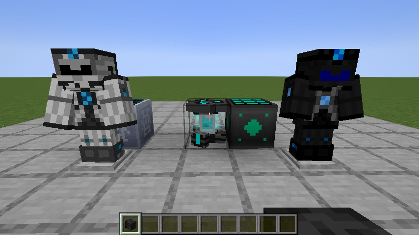
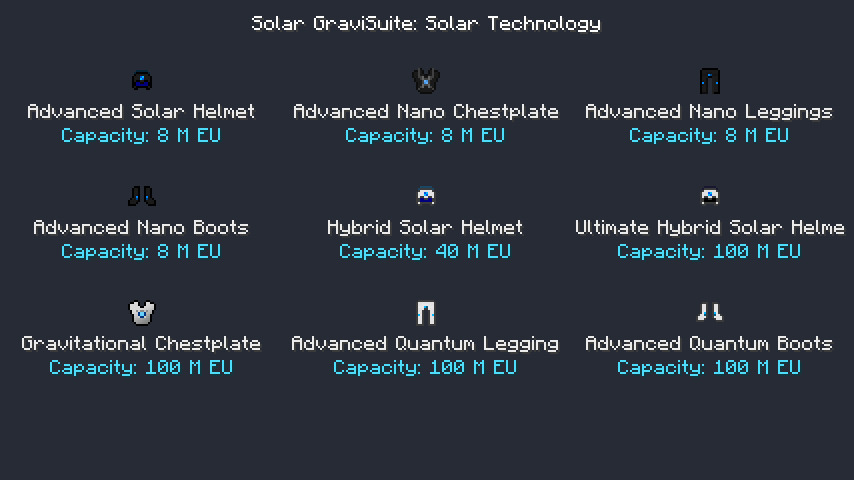
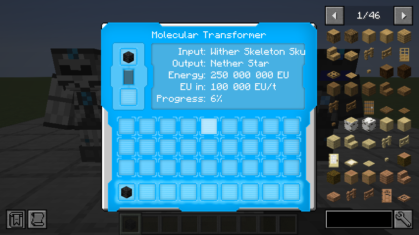

# Solar GraviSuite for IC2R

**Advanced Solar Panels + GraviSuite in one mod** for Minecraft **1.21.1 / NeoForge** and
**IndustrialCraft 2: Refactored (IC2R)**. Solar generation, powered equipment and mobility share
one release, one mod container and one installation JAR. English and Russian are included.



## Requirements and installation

- Minecraft **1.21.1**, NeoForge **21.1.264+**, Java **21**.
- IC2R **21.1.67+ within 21.x**, installed separately.
- Optional: JEI for crafting and Molecular Transformer recipes.

Install `solar-gravisuite-neoforge-1.21.1-1.1.0.jar` on **both client and server**.
Remove the separate Advanced Solar Panels and GraviSuite JARs when replacing them. The combined
mod explicitly rejects a standalone `gravisuite` mod to prevent duplicate registrations.
The sources JAR is for development only.

This project continues AdvancedSolarPanels-IC2R. The public repository is now
[Igoryok95/SolarGraviSuite-IC2R](https://github.com/Igoryok95/SolarGraviSuite-IC2R).
The old `advanced_solar_panels:*` and `gravisuite:*` registry IDs and data-component keys are
retained, including existing equipment charge, machines, recipes, portals and key bindings.
There is one `advanced_solar_panels` mod container, displayed as **Solar GraviSuite for IC2R**;
its two creative tabs organize solar technology and equipment.

## Solar progression

| Panel | Day EU/t | Night / rain EU/t | Storage EU | Output tier |
| --- | ---: | ---: | ---: | ---: |
| Advanced | 8 | 1 | 32,000 | 1 |
| Hybrid | 64 | 8 | 100,000 | 2 |
| Ultimate Hybrid | 512 | 64 | 1,000,000 | 3 |
| Quantum | 4,096 | 2,048 | 10,000,000 | 5 |
| Spectral | 8,192 | 4,096 | 100,000,000 | 5 |
| Singular | 32,768 | 16,384 | 1,000,000,000 | 6 |
| Light Absorbing | 131,072 | 65,536 | 1,000,000,000 | 7 |
| Photonic | 524,288 | 262,144 | 1,000,000,000 | 8 |

Panels need an unobstructed sky. Opaque roofs and dimensions without skylight stop generation.
EU is generated every server tick, buffered, offered to an inserted electric item and emitted
through IC2R's real energy network. Match cables and transformers to each panel's voltage tier.
Higher tiers require their predecessor and late-game components. World generation is unchanged.

## Powered armor and solar helmets

| Equipment | Capacity EU | Transfer EU/t | Tier | Features |
| --- | ---: | ---: | ---: | --- |
| Advanced Solar Helmet | 8,000,000 | 5,000 | 3 | Nano helmet abilities, 8 / 1 EU/t solar generation |
| Advanced Nano Chestplate | 8,000,000 | 5,000 | 3 | Nano protection, advanced jetpack, hover, boost, held-tool charging |
| Advanced Nano Leggings | 8,000,000 | 5,000 | 3 | Nano protection, +15% sprint speed for 8 EU/t |
| Advanced Nano Boots | 8,000,000 | 5,000 | 3 | Nano protection, heavy-fall absorption while energy lasts |
| Hybrid Solar Helmet | 40,000,000 | 12,000 | 4 | Intermediate quantum helmet, 64 / 8 EU/t solar generation |
| Ultimate Hybrid Solar Helmet | 100,000,000 | 50,000 | 4 | Quantum helmet abilities, 512 / 64 EU/t solar generation |
| Gravitational Chestplate | 100,000,000 | 50,000 | 4 | Powered creative flight, boost, energy-backed protection |
| Advanced Quantum Leggings | 100,000,000 | 50,000 | 4 | IC2R quantum sprint / swimming abilities |
| Advanced Quantum Boots | 100,000,000 | 50,000 | 4 | IC2R quantum jump and reduced fall energy cost |

The full advanced nano set now has **8 million EU per piece**; the top quantum / gravitational
set has **100 million EU per piece**. The hybrid helmet remains an intermediate step.
Each upgrade requires the corresponding IC2R equipment. IC2R powered armor behavior and voltage
tiers are retained; no duplicate base nano / quantum equipment or additional helmets are added.



The new leggings and boots have blue energy details in both item icons and worn armor,
matching the existing chestplates. Existing chestplate and solar helmet artwork is retained.
Nano boots retain the 5,000 EU-per-damage fall cost while removing the base heavy-fall cutoff;
quantum boots spend 10,000 instead of 20,000 EU per point beyond the first ten blocks.

Solar helmets generate only while worn and charge chest / legs / boots first, then offhand and
inventory, then their own buffer. Each generated EU is allocated once. Upgrade recipes use
IC2R's shaped serializer and carry charge from ingredients into the result.

## Tools, mobility and storage

| Equipment | Capacity EU | Tier | Features |
| --- | ---: | ---: | --- |
| Advanced Lappack | 40,000,000 | 4 | Upgrade of IC2R's 20M EU lappack, held-tool charging |
| Ultimate Lappack | 100,000,000 | 4 | Portable EU storage and tool charging |
| Advanced Electric Jetpack | 4,000,000 | 3 | Stronger thrust, hover and boost |
| Advanced Diamond Drill | 45,000 | 2 | 3x3 mining, efficiency modes and torch placement |
| Advanced Iridium Drill | 1,000,000 | 3 | IC2R iridium-drill upgrade, 3x3 mining, Silk Touch / Fortune III |
| Advanced Chainsaw | 45,000 | 2 | Faster cutting, IC2R shearing and bounded tree felling |
| Vajra | 10,000,000 | 3 | Universal tool, vein / connected mining, Silk Touch / Fortune III |
| GraviTool | 100,000 | 2 | Electric wrench, treetap, hoe and block rotation |
| Magnet | 10,000 | 1 | Attracts dropped items while enabled in the hotbar |
| Voider | 10,000 | 1 | Removes matching inventory items using an explicitly chosen filter |
| Relocator | 10,000,000 | 4 | Ten destinations, personal teleportation, translocator orbs and temporary portals |

Relocator costs: 1M EU within one dimension, 1.5M across dimensions, 2M for a translocator orb
and 2.5M for a portal orb. The server validates destinations and rejects obstructed locations.
Original IC2R progression recipes, including its quantum chestplate recipe, remain available.

## Molecular Transformer

The transformer uses IC2R EU and 15 native, synchronized datapack recipes for vanilla materials,
sunnarium, iridium and IC2R dust / isotopes. It retains the original 3D geometry, animated core,
dynamic GUI and optional JEI category. This is an adapted recipe set, not exact historical parity.

- Input is consumed only when a conversion completes.
- Blocked output pauses work without consuming input or energy.
- Changing input resets incompatible partial work.
- Input, output, buffered EU and partial work survive saving.



Example datapack recipe under `data/<namespace>/recipe/`:

```json
{
  "type": "advanced_solar_panels:molecular_transformer",
  "input": { "item": "minecraft:glowstone_dust" },
  "output": { "id": "advanced_solar_panels:sunnarium_part", "count": 1 },
  "energy": 1000000
}
```

The creative-only Quantum Generator produces a fixed 512 EU/t, stops with redstone power and
has no survival recipe. Crafting components reuse IC2R's uranium ingot instead of a duplicate.

## Controls

Bindings can be changed in Minecraft's Controls screen.

- **G**: toggle the worn GraviSuite flight engine.
- **H**, or right-click the magnet: toggle the hotbar magnet.
- **IC2 mode key + right-click**: cycle tool / mining / relocator mode.
- **IC2 Alt key + right-click**: cycle mining efficiency.
- **Sneak + IC2 mode key + right-click** with the iridium drill or Vajra: Silk Touch / Fortune III.
- The same combination with the chainsaw: toggle tree felling.
- **Sneak while mining**: operate on one block.
- **Right-click a block** with a drill or Vajra: place a torch from inventory.
- **Right-click a block** with the voider: choose its filter; **sneak + right-click**: apply it.
- **Sneak + right-click** with the relocator: manage saved destinations.
- IC2 jump / boost / quantum movement controls retain their usual functions.

## Configuration

Both existing common config names are retained:

- `config/advanced_solar_panels-common.toml`: `generationMultiplier` (default 1.0, range 0-64),
  `helmetsChargeArmorOnly` (false), `drawActiveTransformerCore` (true).
- `config/gravisuite-common.toml`: `magnetRange` (8), `veinLimit` (64), `treeLimit` (128),
  `portalLifetimeTicks` (400), `showHud` (true).

Use matching settings on client and server. Recipes can be changed with datapacks.

## Build and validation

```sh
./gradlew build runGameTestServer
```

Use Java 21. The public [IC2R 21.1.67 release](https://github.com/Igoryok95/IC2R/releases/tag/21.1.67)
is resolved automatically. For a local dependency, pass
`-Pic2rJar=/absolute/path/to/ic2-neoforge-21.1.67.jar`. No separate GraviSuite dependency is used.

The combined suite has **40 NeoForge server game tests and 9 JUnit resource tests**. It covers
solar generation, charging / EU conservation, real energy-network transfer, armor capacities,
charge-preserving recipes / serialization, mining, flight cleanup, fall protection, portals,
packet validation, machine persistence, GUI parsing, localization and blue armor resources.

The isolated client smoke command is `./gradlew runClient -PclientSmoke`. It opens
`run/saves/SolarClientSmoke`, places solar machines and two equipped armor stands, renders
item / world / GUI captures and exits. Prepare this isolated world by copying `run/world` to
`run/saves/SolarClientSmoke` after a server test run. The developer harness is disabled unless
explicitly enabled and clears old test inventories / dropped items / armor stands.

A real English-locale client with IC2R 21.1.67 and JEI 19.64.0.455 loads the combined mod,
renders both complete armor sets and blue leg / boot details, and opens the transformer GUI.
The screenshots above were captured from that client.

The full multiplayer modpack, worn movement controls and shader combinations still need manual
validation. No Sodium / Iris incompatibility rule is imposed. Historical double-slab cosmetics,
exact old GUI styling, helmet dye recipes and legacy engine audio are outside this release.

## Credits and history

Original ASP: **Icedfire, SeNtiMeL, Chocohead**, original textures including **Krezzard**.
Original GraviSuite: **SeNtiMeL and the IC2 Dev Team**. GraviSuite Reforged implementation and
assets: **VintageModsReforged and upstream contributors**. NeoForge / IC2R adaptation: **Igoryok95**.

See [NOTICE.md](NOTICE.md) for exact source revisions and asset provenance. GraviSuite's port
history is retained as a parent of the integration commit; historical 1.6.4 sources and the
3.0.0 port README are retained under [legacy/gravisuite](legacy/gravisuite).
This is an unofficial adaptation, not a release by the original IC2 / ASP authors.
