# IC2R Addons

Nuclear Control monitoring, all eight Advanced Machines, four classic solar panel tiers up to Quantum, four solar helmets, powered equipment and optional BuildCraft integration for **Minecraft 1.21.1 / NeoForge** and **IndustrialCraft 2: Refactored**. One addon continues the Nuclear Control / Energy Control, Advanced Machines, Advanced Solar Panels and GraviSuite features, with complete English and Russian localization.

## Version 1.4.3

Version 1.4.3 requires IC2R **21.1.70**. Advanced Machines use the same processing-driven
sound lifecycle as the induction furnace: standby warm-up and cooling are silent;
operating sounds start with actual recipe work and stop when processing stops.
The four basic Advanced Machines now match the induction furnace's total processing
demand of **16 EU/t**, with **1 EU/t** standby. Processing speed and warm-up mechanics are unchanged.
The electric engine keeps the direction
selected with a wrench, including after reloading; automatic alignment still works
before manual rotation. Its inventory slots now match the original Forestry GUI.
GUI and Jade distinguish actual EU received from the grid, EU consumed in conversion
and MJ delivered to the consumer.

The four solar tiers still stop at **Quantum**. Equipment keeps released 1.4.0
balance: Advanced Lappack **40 million EU**, Ultimate Lappack **100 million EU**,
**50,000 EU** transfer and **tier 4**, with their original recipes. No Classic
capacity rebalance, PESU requirements or upper panel recipes are included.

See [release notes](RELEASE_NOTES.md), [machine sound and energy audit](docs/advanced-machines-1.4.3.md),
[engine mechanics](docs/forestry-engine-restoration.md) and [validation](docs/validation/1.4.3.json).

## Requirements and installation

- Java **21**, Minecraft **1.21.1**, NeoForge **21.1.264+**.
- IC2R **21.1.70+ within 21.x**, installed separately.
- Optional: BCCE **BuildCraft 8.0.25** for the EU engine and wrench bridge.
- Optional: **Jade 15.10.6** for engine diagnostics, **JEI** for recipes.

Install `ic2r-addons-neoforge-1.21.1-1.4.3.jar` on both client and server, replacing the previous addon JAR. Do not keep duplicate standalone ASP / GraviSuite / Energy Control / Nuclear Control installations. Forestry and a standalone Advanced Machines JAR are not required.

The mod ID, items, blocks, recipes, networking and resource namespace are **`ic2r_addons`**. Search JEI with `@ic2r`, `@addons` or `@ic2r_addons` to find the complete set. The repository is [Igoryok95/IC2R-Addons](https://github.com/Igoryok95/IC2R-Addons).

### Upgrading from 1.1.1 or 1.2.0

Version 1.2.1 removes Spectral, Singular, Light Absorbing and Photonic panels from crafting and creative / JEI lists. Existing blocks and item stacks of these tiers resolve to Quantum panels, including the older `solar_gravisuite` namespace. Stored charging-slot items survive; buffered EU is capped at Quantum's **10,000,000 EU** capacity, so excess stored EU is discarded.

Registry aliases resolve `solar_gravisuite:*` content to its new `ic2r_addons:*` identity. Existing equipment settings / teleport destinations are read from the previous custom-data compound and migrate on modification. Existing solar and equipment configuration files are copied to their new names only if the new files do not exist. Keep a world backup before upgrading a modded installation.

## Nuclear Control monitoring (1.4.0)

The monitoring core of Energy Control's NeoForge 1.21.1 branch is integrated into the same
`ic2r_addons` mod container, resource namespace and JAR. A separate Energy Control installation
is not required. Original authors and GPL-3.0 source / asset terms are preserved in
[NOTICE.md](NOTICE.md) and the bundled `LICENSES/Energy-Control-GPL-3.0.txt`.

- Information Panels, Advanced Information Panels, Holographic Panels and their extensions;
  a Portable Panel, Card Holder, Kit Assembler and programmable Timer.
- Local / Remote Thermal Monitors, Howler / Industrial Alarms and signal lamps.
  Thermal thresholds produce redstone signals; wire an inverted safe-temperature signal
  into the IC2R reactor to stop it when the threshold is exceeded.
- Reactor cards read native heat, maximum heat, EU/t, running state and remaining fuel life.
  Fuel duration uses IC2R's component wear, including MOX, rather than vanilla item damage.
- Energy / fluid / inventory / redstone / text / time cards, combined storage arrays and
  sensor range / display upgrades. Native EU cards work with IC2R storage, solar panels,
  the Molecular Transformer and all eight Advanced Machines.
- Restored Energy Counter and Average Energy Counter measure actual IC2R network flow.
  Five sides accept EU; the marked front face is the output. The base maximum packet is
  32 EU; up to four IC2R Transformer Upgrades raise it to 128 / 512 / 2048 / 8192 EU.
  Counters retain fractional accumulated EU, sampling time and upgrades on disk. Their
  synchronized menus show cumulative EU, current / average EU/t and include an explicit reset.
- Restored Counter Sensor Kit / Card and classic thermometers. The Digital Thermometer
  has 12,000 EU capacity, tier 1 and consumes 50 EU per reading.
- Jade reports server-owned counter readings and monitor thresholds. JEI includes crafting
  and Kit Assembler recipes. Control uses existing IC2R circuits / machine casings rather
  than registering duplicate components.
- The Kit Assembler preserves partial work across power interruptions and world saving.
- Nuclear Control has one dedicated mod adapter: IC2R. No BuildCraft, AE2, Mekanism,
  Big Reactors or other mod-specific monitoring adapter is added. The existing optional
  BuildCraft electric-engine / wrench bridge is independent of monitoring and remains available.
  Inventory and fluid sensor cards retain their standard core capabilities.

`ic2r_addons-control.toml` controls refresh periods, range, allowed / custom alarm sounds and
the dedicated-server translation language (`en_us` / `ru_ru`). External web monitoring is
disabled by default. Sensor reads do not force-load an unloaded target chunk.
All interface labels, tooltips, messages and configuration labels have English / Russian keys.

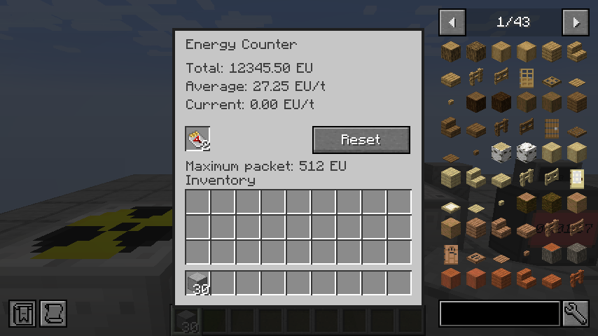
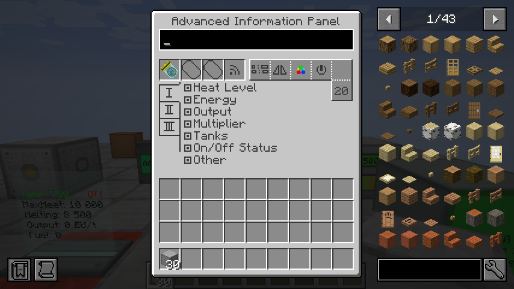
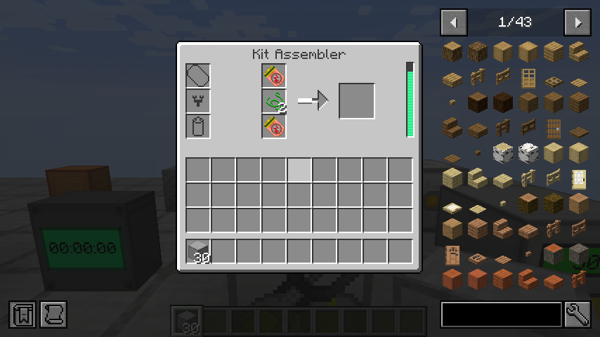
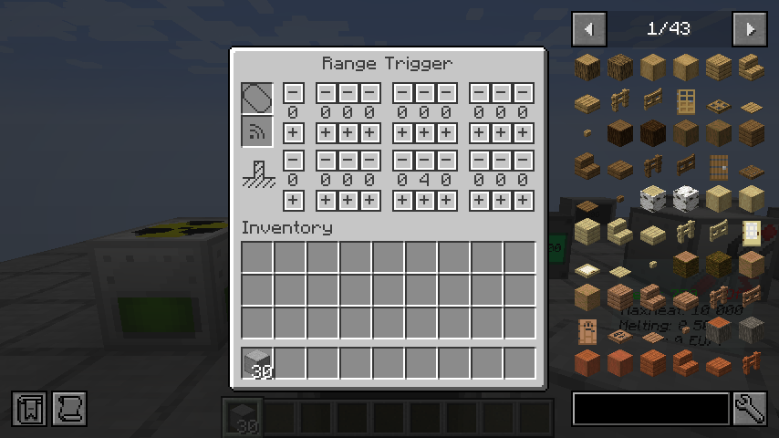

## Advanced Machines

Version 1.3.0 integrates the complete eight-machine set from Advanced Machines. The induction
furnace remains the existing IC2R machine. All new machines use the native EU network, IC2R
processing recipes and synchronized inventories; datapack changes to those recipes apply here too.

| Machine | Processing | Active / idle EU/t | Output slots |
| --- | --- | ---: | ---: |
| Rotary Macerator | Macerator recipes | 16 / 1 | 2 |
| Singularity Compressor | Compressor recipes | 16 / 1 | 1 |
| Centrifuge Extractor | Extractor recipes | 16 / 1 | 3 |
| Compacting Recycler | IC2R recycling; 9 scrap into 1 scrap box | 16 / 1 | 1 |
| Liquescent Extruder | Metal Former extruding recipes | 24 / 1 | 3 |
| Impellerized Roller | Metal Former rolling recipes | 24 / 1 | 1 |
| Water-Jet Cutter | Metal Former cutting recipes | 24 / 1 | 1 |
| Thermal Washer | Ore Washing Plant recipes | 48 / 6 | 3 |

- Tier **2**, **128 EU** maximum input packets, **10,000 EU** internal buffer.
- Running or powered redstone standby increases warm-up by one unit per tick, up to 10,000
  (8 minutes 20 seconds from cold). Without sufficient power / water, it cools by two per tick.
- At maximum warm-up, a normal operation takes **12 ticks**; the recycler takes **1 tick**.
  Redstone maintains warm-up while the machine waits, at the idle cost shown above.
- Two upgrade slots support redstone behavior and item import / export; water machines also
  support fluid import. Overclockers, transformer and storage upgrades are not accepted,
  matching the original Advanced Machines progression.
- Water machines have **8,000 mB** tanks, accept water through fluid pipes or container slots,
  and return empty containers. The cutter uses **500 mB** per operation plus up to **2 mB/t**
  to maintain pressure. The washer uses half the corresponding IC2R washing recipe's water
  (normally **500 mB**) plus up to **5 mB/t** for heat maintenance.
- **Thermal Washer hazard:** refilling an empty tank at **50% heat or higher** causes a thermal
  explosion, as in the original addon. Keep it supplied with water or let it cool first.
  Loading a filled hot machine from disk does not count as refilling.
- Recycling preserves IC2R's blacklist / whitelist and **1-in-8** scrap chance. Packing nine
  scrap is guaranteed; batches smaller than nine wait instead of being recycled away.
- Blocked outputs pause partial work and do not consume processing EU or input. Warm-up,
  partial work, inventory, EU and water survive world saving. Changing input resets partial work.
- Standby warm-up and cooling are silent. Operating sounds follow actual recipe processing,
  using IC2R's native start, loop, normal stop and interruption handling, as on the induction furnace.

Each machine is crafted from its base IC2R machine, an advanced machine casing and the original
specialized components. Rotary Macerator crafting also uses the restored Sharpened Iron Plate.
Use an IC2R wrench to retain the upgraded machine when dismantling it.

JEI lists the seven corresponding IC2R processing categories and a separate scrap-packing
category for the recycler. Jade adds synchronized warm-up, progress, EU/t and water readings,
including the hot-empty washer warning. Both integrations remain optional.
The original modern **32x32** machine faces and active models are retained, with attribution in
[NOTICE.md](NOTICE.md). World generation is unchanged.

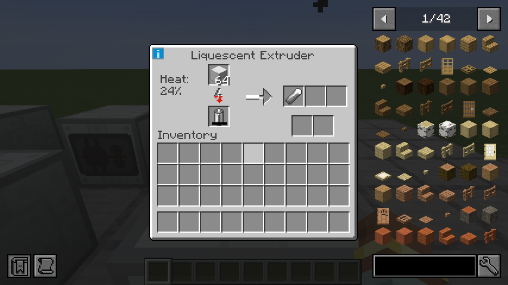
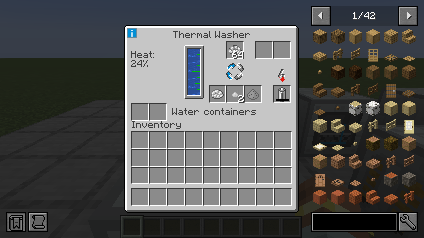
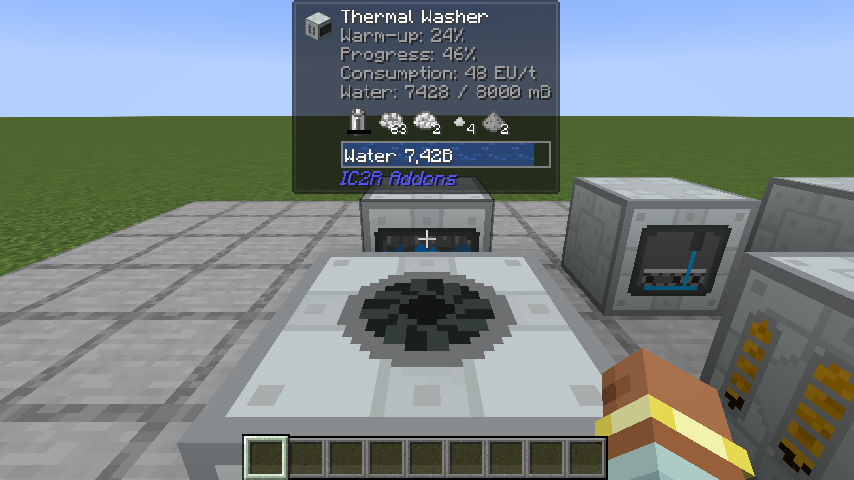

## Optional BuildCraft bridge

The bridge loads only when `buildcraftenergy` is installed. Without BuildCraft, the engine is not registered and its recipe is skipped; all solar and equipment features remain available. Jade and JEI are independently optional.

### EU-powered electric engine

`IC2R cable → Electric Engine → BuildCraft Kinesis pipe / MJ machine`

- Native EU input on sides/rear; native MJ output from the piston. Automatically
  faces a valid neighboring consumer until a wrench selects a direction. The manual
  direction survives ticks, neighbor updates and world reloads. Replacing the engine
  restores automatic alignment. BCCE topology and passive extraction
  capabilities allow wood Kinesis pipes to connect and pull MJ correctly.
- Default **5 EU/t → 2 MJ/t**, **10,000 EU** input storage, tier 2 / **128 EU**
  packets and a separate **10,000 MJ** output buffer.
- Four IC2R upgrade slots accept Overclocker, Energy Storage and Transformer
  upgrades. Generation is capped at **8 MJ/t**; native increasing EU costs apply.
- Requires redstone by default. Conversion stops when the MJ buffer is full.
  Simulation does not spend energy; all extraction paths share one delivery budget.
- Forestry thermal stages control piston speed, gradual cooling and forced
  cooldown. Switching off completes the current stroke. Heat grants no extra
  energy multiplier. Right-click opens the original Forestry electrical-engine
  background with a battery, four IC2R upgrades and live status/energy information.
- ForestryCE geometry and textures are preserved; held-item transforms use normal
  Minecraft/BC block scale. No Forestry mod or circuit-board dependency is required.

`ic2r_addons-buildcraft.toml` controls `enabled`, `euCapacity`, `inputTier`,
`baseEuPerTick`, `mjPerEu` and `requireRedstone`. `baseEuPerTick` replaces old
`euPerTick` so the former 32 EU/t default does not override the new balance.
BC's FE auto-conversion setting is independent. See [mechanics and sources](docs/forestry-engine-restoration.md).

### Wrenches

IC2R manual/electric wrenches and GraviTool work on BC blocks. BC's wrench uses
IC2R right-click rotation and left-click dismantling on IC2R machines. Native BC
pipe activation runs before the rotation fallback, including iron pipe output
switching. Electric pipe actions cost 100 EU once; empty tools and canceled
interactions remain blocked.

### Jade

The server-owned overlay shows blue **EU** and red **MJ** bars, colored thermal
stage, temperature, redstone, input voltage and stop reason. **From grid** measures
EU received through the IC2R network; **Consumption** measures EU spent generating
MJ; **Output** measures MJ actually delivered. These are live rates, not fixed
localized values. A disconnected engine can consume stored EU with zero grid input.
Battery discharge is separate from the grid reading. The same readings appear in the GUI.
Jade is independently optional.

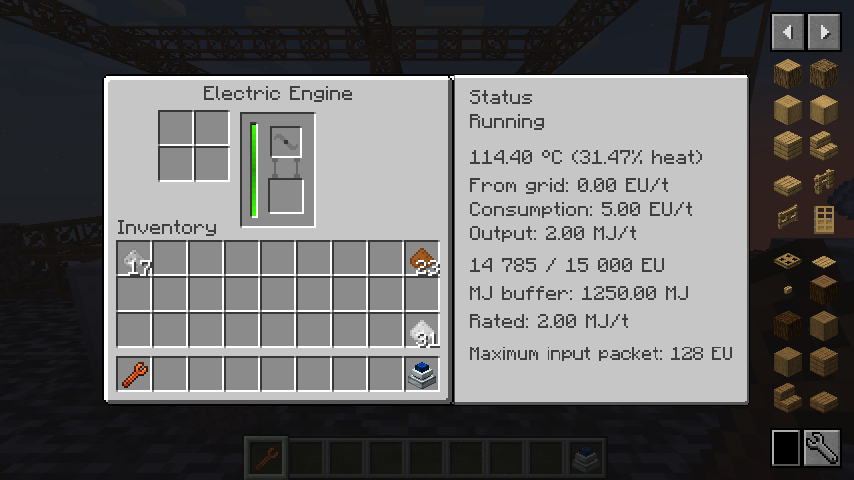
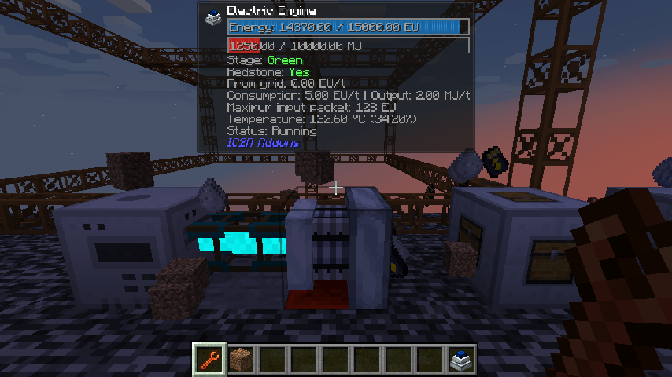

## Textures and item colors

Advanced Machines have yellow titles. Original ASP rarity progression is yellow
for Advanced, cyan for Hybrid and purple for Ultimate/Quantum, including helmets.
GraviSuite item rarities distinguish ordinary upgrades, advanced drills and epic
gear. IC2R sensor kit/card names are present in both languages.

Six advanced tool/mode icons reuse native **32x32 IC2R** sprites with only orange
grip pixels recolored blue. Metal, drill tips, silhouettes and alpha are unchanged.
Vajra restores its original transparent openings, redrawn at native 32x32 with independent pixel detail. Hybrid/Ultimate helmets and worn armor keep their existing
artwork. See [texture tooling](tools/textures/README.md) and [NOTICE.md](NOTICE.md).

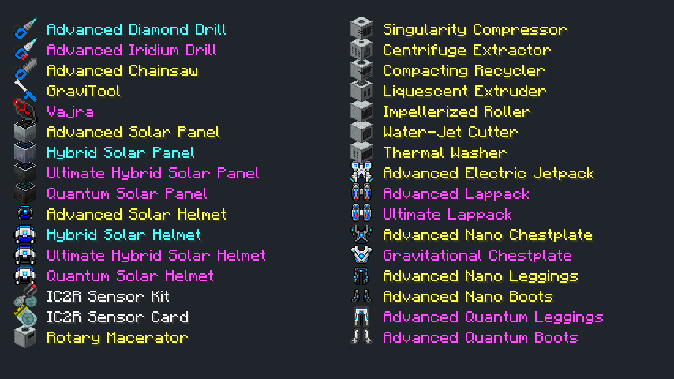

## Solar progression

| Panel | Day EU/t | Night / rain EU/t | Storage EU | Output tier |
| --- | ---: | ---: | ---: | ---: |
| Advanced | 8 | 1 | 32,000 | 1 |
| Hybrid | 64 | 8 | 100,000 | 2 |
| Ultimate Hybrid | 512 | 64 | 1,000,000 | 3 |
| Quantum | 4,096 | 2,048 | 10,000,000 | 5 |

Panels need an unobstructed sky. Opaque roofs and dimensions without skylight stop generation.
EU is generated every server tick, buffered, offered to an inserted electric item and emitted
through IC2R's real energy network. Match cables and transformers to each panel's voltage tier.
Higher tiers require their predecessor and late-game components. World generation is unchanged.

## Powered armor and solar helmets

| Equipment | Capacity EU | Transfer EU/t | Tier | Features |
| --- | ---: | ---: | ---: | --- |
| Advanced Solar Helmet | 8,000,000 | 5,000 | 3 | Nano helmet abilities, 8 / 1 EU/t solar generation |
| Advanced Nano Chestplate | 8,000,000 | 5,000 | 3 | Nano protection, advanced jetpack, hover, boost, held-tool charging |
| Advanced Nano Leggings | 8,000,000 | 5,000 | 3 | Nano protection, +15% sprint speed for 8 EU/t |
| Advanced Nano Boots | 8,000,000 | 5,000 | 3 | Nano protection, heavy-fall absorption while energy lasts |
| Hybrid Solar Helmet | 40,000,000 | 12,000 | 4 | Intermediate quantum helmet, 64 / 8 EU/t solar generation |
| Ultimate Hybrid Solar Helmet | 100,000,000 | 50,000 | 4 | Quantum helmet abilities, 512 / 64 EU/t solar generation |
| Quantum Solar Helmet | 100,000,000 | 200,000 | 5 | Quantum helmet abilities, 4,096 / 2,048 EU/t solar generation |
| Gravitational Chestplate | 100,000,000 | 50,000 | 4 | Powered creative flight, boost, energy-backed protection |
| Advanced Quantum Leggings | 100,000,000 | 50,000 | 4 | IC2R quantum sprint / swimming abilities |
| Advanced Quantum Boots | 100,000,000 | 50,000 | 4 | IC2R quantum jump and reduced fall energy cost |

The full advanced nano set now has **8 million EU per piece**; the top quantum / gravitational
set has **100 million EU per piece**. The hybrid helmet remains an intermediate step.
Each upgrade requires the corresponding IC2R equipment. IC2R powered armor behavior is retained. The Quantum Solar Helmet is the fourth solar tier,
crafted from an Ultimate Hybrid Solar Helmet, a Quantum Solar Panel, two advanced circuits
and a lapotron crystal. Its 100M EU buffer matches the top armor set; its tier-5 charging
and solar output improve on the tier-4 Ultimate helmet. Base IC2R nano / quantum recipes remain available.


The new leggings and boots have blue energy details in both item icons and worn armor,
matching the existing chestplates. Original equipment silhouettes are retained, with refreshed pixel detail and blue energy accents.
Nano boots retain the 5,000 EU-per-damage fall cost while removing the base heavy-fall cutoff;
quantum boots spend 10,000 instead of 20,000 EU per point beyond the first ten blocks.

Solar helmets generate only while worn and charge chest / legs / boots first, then offhand and
inventory, then their own buffer. Each generated EU is allocated once. Upgrade recipes use
IC2R's shaped serializer and carry charge from ingredients into the result.

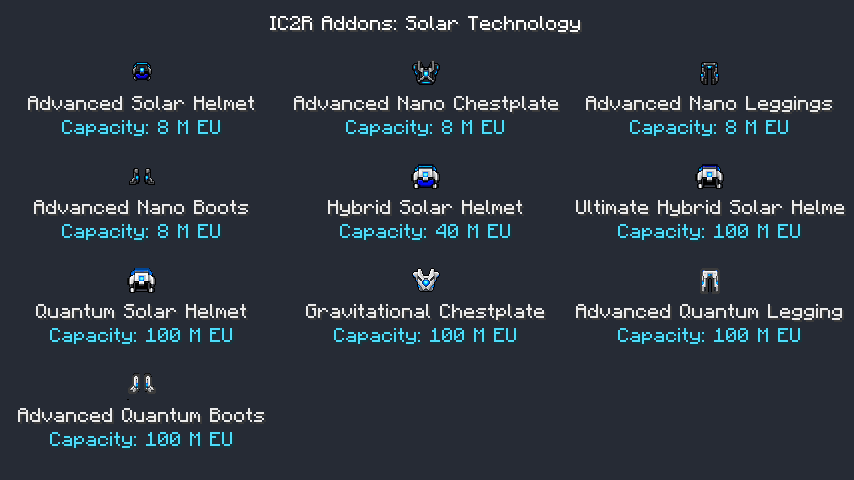

## Tools, mobility and storage

| Equipment | Capacity EU | Tier | Features |
| --- | ---: | ---: | --- |
| Advanced Lappack | 40,000,000 | 4 | Upgrade of IC2R's 20M EU lappack, held-tool charging |
| Ultimate Lappack | 100,000,000 | 4 | Portable EU storage and tool charging |
| Advanced Electric Jetpack | 4,000,000 | 3 | Stronger thrust, hover and boost |
| Advanced Diamond Drill | 45,000 | 2 | 3x3 mining, efficiency modes and torch placement |
| Advanced Iridium Drill | 1,000,000 | 3 | IC2R iridium-drill upgrade, 3x3 mining, Silk Touch / Fortune III |
| Advanced Chainsaw | 45,000 | 2 | Faster cutting, IC2R shearing and bounded tree felling |
| Vajra | 10,000,000 | 3 | Universal tool, vein / connected mining, Silk Touch / Fortune III |
| GraviTool | 100,000 | 2 | Electric wrench, treetap, hoe and block rotation |
| Magnet | 10,000 | 1 | Attracts dropped items while enabled in the hotbar |
| Voider | 10,000 | 1 | Removes matching inventory items using an explicitly chosen filter |
| Relocator | 10,000,000 | 4 | Ten destinations, personal teleportation, translocator orbs and temporary portals |

Relocator costs: 1M EU within one dimension, 1.5M across dimensions, 2M for a translocator orb
and 2.5M for a portal orb. The server validates destinations and rejects obstructed locations.
Original IC2R progression recipes, including its quantum chestplate recipe, remain available.

## Molecular Transformer

The transformer uses IC2R EU and 15 native, synchronized datapack recipes for vanilla materials,
sunnarium, iridium and IC2R dust / isotopes. It retains the original 3D geometry, animated core,
dynamic GUI and optional JEI category. This is an adapted recipe set, not exact historical parity.

- Input is consumed only when a conversion completes.
- Blocked output pauses work without consuming input or energy.
- Changing input resets incompatible partial work.
- Input, output, buffered EU and partial work survive saving.


Example datapack recipe under `data/<namespace>/recipe/`:

```json
{
  "type": "ic2r_addons:molecular_transformer",
  "input": { "item": "minecraft:glowstone_dust" },
  "output": { "id": "ic2r_addons:sunnarium_part", "count": 1 },
  "energy": 1000000
}
```

The creative-only Quantum Generator produces a fixed 512 EU/t, stops with redstone power and
has no survival recipe. Crafting components reuse IC2R's uranium ingot instead of a duplicate.

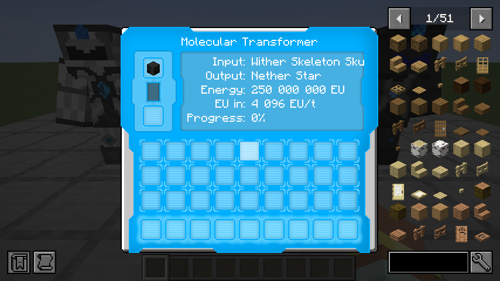

## Controls

Bindings can be changed in Minecraft's Controls screen.

- **G**: toggle the worn armor flight engine.
- **H**, or right-click the magnet: toggle the hotbar magnet.
- **IC2 mode key + right-click**: cycle tool / mining / relocator mode.
- **IC2 Alt key + right-click**: cycle mining efficiency.
- **Sneak + IC2 mode key + right-click** with the iridium drill or Vajra: Silk Touch / Fortune III.
- The same combination with the chainsaw: toggle tree felling.
- **Sneak while mining**: operate on one block.
- **Right-click a block** with a drill or Vajra: place a torch from inventory.
- **Right-click a block** with the voider: choose its filter; **sneak + right-click**: apply it.
- **Sneak + right-click** with the relocator: manage saved destinations.
- IC2 jump / boost / quantum movement controls retain their usual functions.

## Configuration

Common configuration is organized into three files:

- `config/ic2r_addons-solar.toml`: `generationMultiplier` (default 1.0, range 0-64),
  `helmetsChargeArmorOnly` (false), `drawActiveTransformerCore` (true).
- `config/ic2r_addons-equipment.toml`: `magnetRange` (8), `veinLimit` (64), `treeLimit` (128),
  `portalLifetimeTicks` (400), `showHud` (true).

- `config/ic2r_addons-buildcraft.toml`: optional bridge settings listed above. Restart after changing voltage or buffer settings.

Use matching settings on client and server. Recipes can be changed with datapacks.

## Build and validation

Use Java 21 and IC2R **21.1.70**. A locally built core JAR can be supplied explicitly:

```sh
./gradlew spotlessApply build runGameTestServer -Pic2rJar=/absolute/path/ic2-neoforge-21.1.70.jar
./gradlew runGameTestServer -Pic2rJar=/absolute/path/ic2-neoforge-21.1.70.jar -PwithBC -PwithJade
./gradlew runClient -Pic2rJar=/absolute/path/ic2-neoforge-21.1.70.jar -PwarmupSmoke -PwithBC -PwithJade
```

Released dependencies resolve from GitHub / Modrinth / JEI. IC2R 21.1.70 is required. CI consumes the released IC2R 21.1.70 JAR, matching the installed binary.
[GitHub CI](https://github.com/Igoryok95/IC2R-Addons/actions/runs/40214251720) and local checks pass **19 JUnit**, **82 standalone Addons** and **94 optional
integration GameTests**; see [1.4.1 validation](docs/validation/1.4.1.json).

The historical 1.4.0 checks below describe the published release.

The 1.4.0 regression suite contains **16 JUnit checks**, **75 server GameTests without BC**
and **83 with BC**, with Jade present and absent. The control client smoke opens eight real
menus plus thermal / alarm settings, verifies seven empty-slot sprites, 17 block models and
45 registered item models, checks a working assembler / timer and captures each control block.
It runs in English and Russian; documentation images use English. See
[the current validation manifest](docs/validation/1.4.0.json) for completed runs.

The earlier [1.3.0 machine validation](docs/validation/1.3.0.json) also records all eight
processing menus, 96 active / inactive model faces, real partial processing and JEI searches.

The server suites exercise the eight advanced machines, processing / water / automation, real IC2
energy-network transfers, redstone warm-up, blocked outputs, saving, wrench use, buckets and thermal
shock, alongside solar generation, powered equipment, migration aliases and the EU-to-MJ engine.
JUnit checks verify recipes, models, 32x32 machine faces, English / Russian coverage, format arguments
and existing equipment resources. Development smoke hooks are disabled in normal play.

The client smoke modifies only its isolated `run/saves/SolarClientSmoke` development world. It does not use the installed modpack or multiplayer server.

## Credits and history

Original Advanced Machines: immibis, Chocohead and contributors; Forge reference port: craftorio. Original Advanced Solar Panels: Icedfire, SeNtiMeL, Chocohead and contributors. Solar-tier extensions: VintageModsReforged. GraviSuite: SeNtiMeL, the IC2 Dev Team and VintageModsReforged. ForestryCE engine artwork / geometry: Forestry contributors and thedarkcolour. Energy Control: Zuxelus. Nuclear Control: Shedar, Xbony2, dmf444, Pyrolusite and contributors. NeoForge IC2R adaptation and integration: **Igoryok95**.

Original copyrights and applicable licenses remain in force. See [NOTICE.md](NOTICE.md) and bundled `LICENSES/ForestryCE-LGPL-3.0.txt`.
