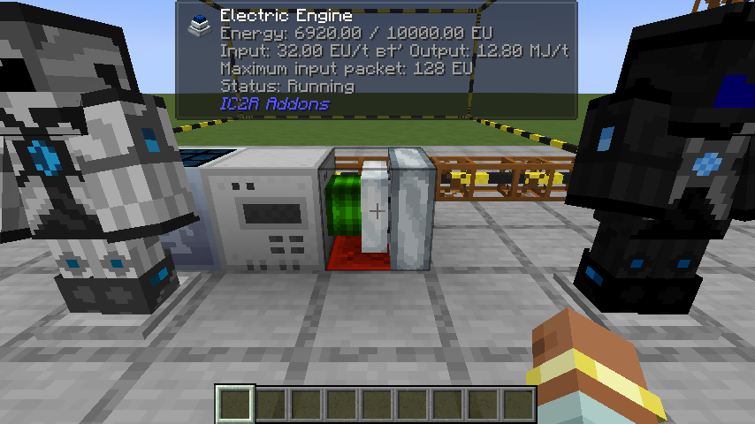
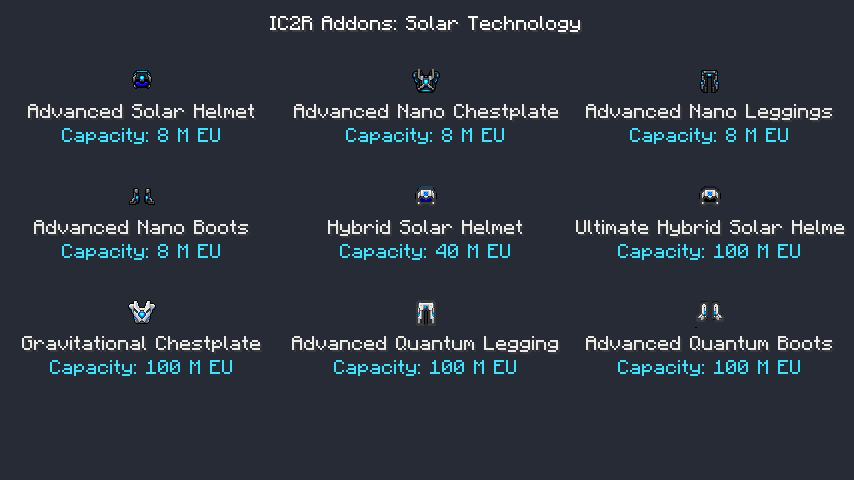
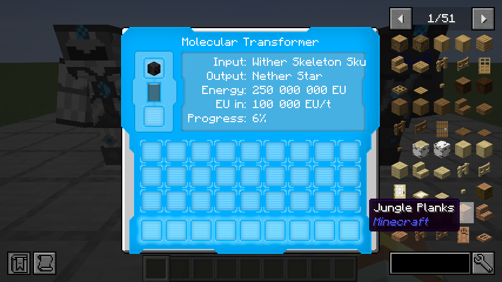

# IC2R Addons

Advanced solar power, powered equipment and optional BuildCraft integration for **Minecraft 1.21.1 / NeoForge** and **IndustrialCraft 2: Refactored**. One addon continues the Advanced Solar Panels and GraviSuite features, with complete English and Russian localization.

## Requirements and installation

- Java **21**, Minecraft **1.21.1**, NeoForge **21.1.264+**.
- IC2R **21.1.67+ within 21.x**, installed separately.
- Optional: BCCE **BuildCraft 8.0.25** for the EU engine and wrench bridge.
- Optional: **Jade 15.10.6** for engine diagnostics, **JEI** for recipes.

Install `ic2r-addons-neoforge-1.21.1-1.2.0.jar` on both client and server, replacing the previous Solar GraviSuite JAR. Do not keep duplicate standalone ASP / GraviSuite installations. Forestry is not required.

The mod ID, items, blocks, recipes, networking and resource namespace are **`ic2r_addons`**. Search JEI with `@ic2r`, `@addons` or `@ic2r_addons` to find the complete set. The repository is [Igoryok95/IC2R-Addons](https://github.com/Igoryok95/IC2R-Addons).

### Upgrading from 1.1.1

Registry aliases resolve `solar_gravisuite:*` content to its new `ic2r_addons:*` identity. Existing equipment settings / teleport destinations are read from the previous custom-data compound and migrate on modification. Existing solar and equipment configuration files are copied to their new names only if the new files do not exist. Keep a world backup before upgrading a modded installation.

## Optional BuildCraft bridge

The bridge loads only when `buildcraftenergy` is installed. Without BuildCraft, the engine is not registered and its recipe is skipped; all solar and equipment features remain available. Jade and JEI are independently optional.

### EU-powered electric engine

`IC2R cable → Electric Engine → BuildCraft Kinesis pipe / MJ machine`

- Takes native **IC2R EU** on every side except the piston output face.
- Outputs native **BuildCraft MJ** through the piston face, directly or through Kinesis pipes.
- Defaults: **10,000 EU** buffer, **tier 2 / 128 EU input packets**, **32 EU/t maximum consumption**, **0.4 MJ per EU** (up to **12.8 MJ/t**).
- Requires a redstone signal by default. Idle, disconnected and full outputs do not consume EU.
- Simulation never consumes EU; repeated extraction shares one per-tick budget. The EU buffer survives saving / reloading.
- Recipe: tin ingots, an iron BuildCraft gear, IC2R coils, an electric motor and an electronic circuit.
- Engine geometry, textures and piston animation are adapted from ForestryCE's tin / solar engine. Solar panels and Forestry are not dependencies.

`ic2r_addons-buildcraft.toml` controls `enabled`, `euCapacity`, `inputTier`, `euPerTick`, `mjPerEu` and `requireRedstone`. EU-to-MJ conversion does not depend on BC's global FE auto-conversion switch.

### Wrenches

IC2R mechanical / electric wrenches and GraviTool in wrench mode are recognized by BuildCraft. The BC wrench can rotate and dismantle IC2R machines using their wrench behavior: **right-click to rotate**, **left-click mining to dismantle**. Electric-tool operations consume charge; empty tools cannot dismantle BC machines. Special BC pipe interactions remain available.

### Jade

The localized engine overlay shows stored / maximum EU, actual EU/t and MJ/t, maximum input packet and the current state: running, waiting for redstone, no energy, no consumer, full output or bridge disabled. It uses server-provided data. Without Jade the engine still works.

## Textures

The 1.2.0 refresh combines IC2R-style 32-pixel tool detail with the addon's original silhouettes and blue energy accents. Twenty tool, armor and device icons use new generated pixel-art atlases based on the original 16-pixel designs. Remaining component / block art uses edge-aware pixel refinement from the original assets. Armor UV layouts and transparency are preserved. Source artwork, processing instructions and provenance are in `tools/textures` and [NOTICE.md](NOTICE.md).



## Solar progression

| Panel | Day EU/t | Night / rain EU/t | Storage EU | Output tier |
| --- | ---: | ---: | ---: | ---: |
| Advanced | 8 | 1 | 32,000 | 1 |
| Hybrid | 64 | 8 | 100,000 | 2 |
| Ultimate Hybrid | 512 | 64 | 1,000,000 | 3 |
| Quantum | 4,096 | 2,048 | 10,000,000 | 5 |
| Spectral | 8,192 | 4,096 | 100,000,000 | 5 |
| Singular | 32,768 | 16,384 | 1,000,000,000 | 6 |
| Light Absorbing | 131,072 | 65,536 | 1,000,000,000 | 7 |
| Photonic | 524,288 | 262,144 | 1,000,000,000 | 8 |

Panels need an unobstructed sky. Opaque roofs and dimensions without skylight stop generation.
EU is generated every server tick, buffered, offered to an inserted electric item and emitted
through IC2R's real energy network. Match cables and transformers to each panel's voltage tier.
Higher tiers require their predecessor and late-game components. World generation is unchanged.

## Powered armor and solar helmets

| Equipment | Capacity EU | Transfer EU/t | Tier | Features |
| --- | ---: | ---: | ---: | --- |
| Advanced Solar Helmet | 8,000,000 | 5,000 | 3 | Nano helmet abilities, 8 / 1 EU/t solar generation |
| Advanced Nano Chestplate | 8,000,000 | 5,000 | 3 | Nano protection, advanced jetpack, hover, boost, held-tool charging |
| Advanced Nano Leggings | 8,000,000 | 5,000 | 3 | Nano protection, +15% sprint speed for 8 EU/t |
| Advanced Nano Boots | 8,000,000 | 5,000 | 3 | Nano protection, heavy-fall absorption while energy lasts |
| Hybrid Solar Helmet | 40,000,000 | 12,000 | 4 | Intermediate quantum helmet, 64 / 8 EU/t solar generation |
| Ultimate Hybrid Solar Helmet | 100,000,000 | 50,000 | 4 | Quantum helmet abilities, 512 / 64 EU/t solar generation |
| Gravitational Chestplate | 100,000,000 | 50,000 | 4 | Powered creative flight, boost, energy-backed protection |
| Advanced Quantum Leggings | 100,000,000 | 50,000 | 4 | IC2R quantum sprint / swimming abilities |
| Advanced Quantum Boots | 100,000,000 | 50,000 | 4 | IC2R quantum jump and reduced fall energy cost |

The full advanced nano set now has **8 million EU per piece**; the top quantum / gravitational
set has **100 million EU per piece**. The hybrid helmet remains an intermediate step.
Each upgrade requires the corresponding IC2R equipment. IC2R powered armor behavior and voltage
tiers are retained; no duplicate base nano / quantum equipment or additional helmets are added.


The new leggings and boots have blue energy details in both item icons and worn armor,
matching the existing chestplates. Original equipment silhouettes are retained, with refreshed pixel detail and blue energy accents.
Nano boots retain the 5,000 EU-per-damage fall cost while removing the base heavy-fall cutoff;
quantum boots spend 10,000 instead of 20,000 EU per point beyond the first ten blocks.

Solar helmets generate only while worn and charge chest / legs / boots first, then offhand and
inventory, then their own buffer. Each generated EU is allocated once. Upgrade recipes use
IC2R's shaped serializer and carry charge from ingredients into the result.



## Tools, mobility and storage

| Equipment | Capacity EU | Tier | Features |
| --- | ---: | ---: | --- |
| Advanced Lappack | 40,000,000 | 4 | Upgrade of IC2R's 20M EU lappack, held-tool charging |
| Ultimate Lappack | 100,000,000 | 4 | Portable EU storage and tool charging |
| Advanced Electric Jetpack | 4,000,000 | 3 | Stronger thrust, hover and boost |
| Advanced Diamond Drill | 45,000 | 2 | 3x3 mining, efficiency modes and torch placement |
| Advanced Iridium Drill | 1,000,000 | 3 | IC2R iridium-drill upgrade, 3x3 mining, Silk Touch / Fortune III |
| Advanced Chainsaw | 45,000 | 2 | Faster cutting, IC2R shearing and bounded tree felling |
| Vajra | 10,000,000 | 3 | Universal tool, vein / connected mining, Silk Touch / Fortune III |
| GraviTool | 100,000 | 2 | Electric wrench, treetap, hoe and block rotation |
| Magnet | 10,000 | 1 | Attracts dropped items while enabled in the hotbar |
| Voider | 10,000 | 1 | Removes matching inventory items using an explicitly chosen filter |
| Relocator | 10,000,000 | 4 | Ten destinations, personal teleportation, translocator orbs and temporary portals |

Relocator costs: 1M EU within one dimension, 1.5M across dimensions, 2M for a translocator orb
and 2.5M for a portal orb. The server validates destinations and rejects obstructed locations.
Original IC2R progression recipes, including its quantum chestplate recipe, remain available.

## Molecular Transformer

The transformer uses IC2R EU and 15 native, synchronized datapack recipes for vanilla materials,
sunnarium, iridium and IC2R dust / isotopes. It retains the original 3D geometry, animated core,
dynamic GUI and optional JEI category. This is an adapted recipe set, not exact historical parity.

- Input is consumed only when a conversion completes.
- Blocked output pauses work without consuming input or energy.
- Changing input resets incompatible partial work.
- Input, output, buffered EU and partial work survive saving.


Example datapack recipe under `data/<namespace>/recipe/`:

```json
{
  "type": "ic2r_addons:molecular_transformer",
  "input": { "item": "minecraft:glowstone_dust" },
  "output": { "id": "ic2r_addons:sunnarium_part", "count": 1 },
  "energy": 1000000
}
```

The creative-only Quantum Generator produces a fixed 512 EU/t, stops with redstone power and
has no survival recipe. Crafting components reuse IC2R's uranium ingot instead of a duplicate.



## Controls

Bindings can be changed in Minecraft's Controls screen.

- **G**: toggle the worn armor flight engine.
- **H**, or right-click the magnet: toggle the hotbar magnet.
- **IC2 mode key + right-click**: cycle tool / mining / relocator mode.
- **IC2 Alt key + right-click**: cycle mining efficiency.
- **Sneak + IC2 mode key + right-click** with the iridium drill or Vajra: Silk Touch / Fortune III.
- The same combination with the chainsaw: toggle tree felling.
- **Sneak while mining**: operate on one block.
- **Right-click a block** with a drill or Vajra: place a torch from inventory.
- **Right-click a block** with the voider: choose its filter; **sneak + right-click**: apply it.
- **Sneak + right-click** with the relocator: manage saved destinations.
- IC2 jump / boost / quantum movement controls retain their usual functions.

## Configuration

Common configuration is organized into three files:

- `config/ic2r_addons-solar.toml`: `generationMultiplier` (default 1.0, range 0-64),
  `helmetsChargeArmorOnly` (false), `drawActiveTransformerCore` (true).
- `config/ic2r_addons-equipment.toml`: `magnetRange` (8), `veinLimit` (64), `treeLimit` (128),
  `portalLifetimeTicks` (400), `showHud` (true).

- `config/ic2r_addons-buildcraft.toml`: optional bridge settings listed above. Restart after changing voltage or buffer settings.

Use matching settings on client and server. Recipes can be changed with datapacks.

## Build and validation

Use Java 21:

```sh
./gradlew spotlessApply build runGameTestServer
./gradlew runGameTestServer -PwithBC -PwithJade
./gradlew runClient -PclientSmoke -PwithBC -PwithJade
```

Dependencies resolve from the IC2R / BCCE GitHub releases and the Modrinth / JEI Maven repositories. A local IC2R JAR can be supplied with `-Pic2rJar=/absolute/path/to/ic2-neoforge-21.1.67.jar`.

Validation: **11 JUnit checks**, **43 server GameTests without BC** and **51 with BC**, tested with Jade present and absent. Real English / Russian clients received live Jade telemetry and matching JEI results (51 items with BC). See [the validation manifest](docs/validation/1.2.0.json).

The server suites exercise solar generation, real IC2 energy-network transfers, powered equipment, persistence, migration aliases, and the optional EU-to-MJ engine. JUnit resource checks verify recipes, atlas UVs, English / Russian coverage, format arguments, armor texture layouts and item resources. The isolated client smoke verifies rendering, GUI opening and matching JEI search results. It is disabled in normal play.

The client smoke modifies only its isolated `run/saves/SolarClientSmoke` development world. It does not use the installed modpack or multiplayer server.

## Credits and history

Original Advanced Solar Panels: Icedfire, SeNtiMeL, Chocohead and contributors. Solar-tier extensions: VintageModsReforged. GraviSuite: SeNtiMeL, the IC2 Dev Team and VintageModsReforged. ForestryCE engine artwork / geometry: Forestry contributors and thedarkcolour. NeoForge IC2R adaptation and integration: **Igoryok95**.

Original copyrights and applicable licenses remain in force. See [NOTICE.md](NOTICE.md) and bundled `LICENSES/ForestryCE-LGPL-3.0.txt`.
