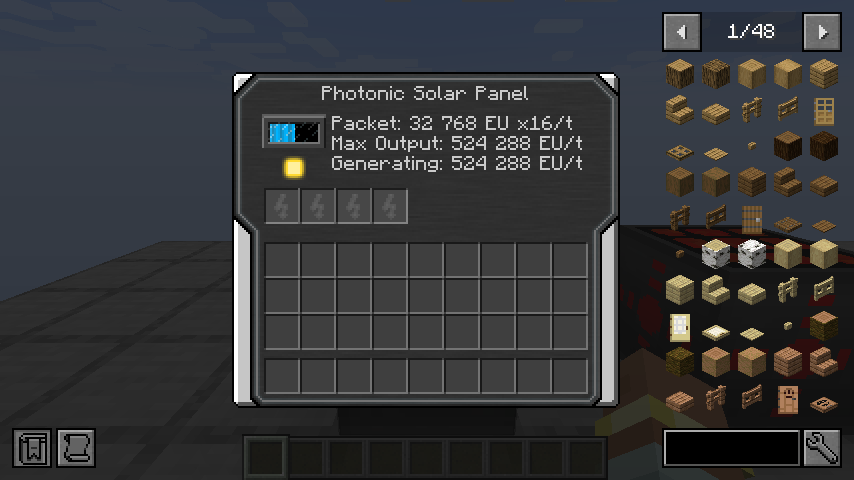

# IC2R 21.1.70 compatibility

This is the compatibility checklist for the Classic restoration in IC2R 21.1.70.
The installed Addons release remains 1.4.0 until both projects pass validation.

- [x] Energy arrays preserve readings beyond 2,147,483,647 EU, including per-target
      values, totals, percentages, portable progress bars and old saved cards.
- [x] Large fluid-tank readings retain their full capacity and amount.
- [x] Basic IC2R Solar Helmet remains the introductory charger before Addons helmets.
- [x] Nano and Quantum / Gravi equipment retain their existing roles and capacities.
- [x] Advanced and Ultimate Lappacks have appropriate capacity, charging rates, tier
      and component costs alongside the new late-game batteries.
- [ ] Colossal recipes consume the existing Advanced Machines rather than duplicate
      blocks from another namespace.
- [x] The Quantum Solar Panel works through the new transformers and cables into
      ESU / ISU / PESU, including overvoltage protection and save / reload behavior.
- [x] Spectral, Singular, Light Absorbing and Photonic panels are restored with
      distinct IC2R recipes, original 32x32 faces and safe late-tier EU packets.
- [x] Existing Nuclear Control, reactor, BC bridge and equipment tests still pass.
- [x] Localizations, recipes, README, changelog, metadata and dependency range updated.
- [ ] Build and test against the final IC2R artifact; update both mods together in
      the client, transfer ZIP and server after a graceful server stop.

The user explicitly requested all of these compatibility changes. Capacity and
recipe changes will be documented with their final values before release.

The saved foundation passes 17 unit tests, 85 server GameTests without BC / Jade,
and 93 with both installed. Actual Russian / English clients check all eight solar
menus and their live tooltips; a Russian client checks all eight Advanced Machines,
their warm-up percentages and visible processing progress. See the
[development validation receipt](validation/classic-compatibility-1.4.1.json).

## Current development changes

- Combined energy cards store per-target values as doubles instead of narrowing to
  integers. Legacy integer cards, missing-target states, totals, percentages and
  portable progress bars remain readable. Multi-tank cards use long-valued readings.
- Shared formatting no longer references client-only Minecraft classes when cards
  generate text on a dedicated server.
- Ultimate Lappack increases from 100 million to 1 billion EU, with 250,000 EU
  transfer and tier 5. Its six Lapotron ingredients become six UESC crystals.
  Advanced Lappack remains 40 million EU / tier 4 and works with MFSU; Ultimate
  requires ISU or later storage. Existing stored charge is preserved rather than
  automatically filling the expanded capacity.
- Gravitational Chestplate stays at 100 million EU. Its recipe uses a Glowtronic
  Crystal instead of consuming the new 1-billion-EU Ultimate Lappack.
- All eight Advanced Machines show their heat / speed / pressure warm-up as
  0–100%, separately from processing progress. Raw state remains 0–10,000 and is
  used unchanged by processing, thermal shock checks and world saving.
- The four extended solar panels return under their original IDs. Each tier keeps
  its previous day / night generation and buffer capacity. Light Absorbing and
  Photonic use the approved tier-6 multi-packet output rather than tier-7/8 voltage.
  The latter safely feeds PESU through plasma cable in an actual energy-network test.
- Solar charge is shown by the existing gauge, with grouped exact EU in its live
  tooltip. Output and packet information fit in the original GUI. Imported panel
  atlases retain six 32x32 faces, with byte hashes recorded in
  [the texture manifest](restored-solar-textures-1.4.1.json).

## Restored solar progression

| Panel | Day EU/t | Night EU/t | Buffer EU | Packet EU | Packets/t |
| --- | ---: | ---: | ---: | ---: | ---: |
| Spectral | 8,192 | 4,096 | 100,000,000 | 8,192 | 1 |
| Singular | 32,768 | 16,384 | 1,000,000,000 | 32,768 | 1 |
| Light Absorbing | 131,072 | 65,536 | 1,000,000,000 | 32,768 | 4 |
| Photonic | 524,288 | 262,144 | 1,000,000,000 | 32,768 | 16 |

The earlier four tiers and the four solar helmets retain their existing profiles.
New recipes require the actual preceding generation capacity rather than multiplying
power from a single inexpensive upgrade:

| Panel | Previous panels | Additional components |
| --- | ---: | --- |
| Spectral | 2 Quantum | 2 irradiant glass panes, Glowtronic Crystal, complex circuit, 2 enriched sunnarium alloys, stabilized machine block |
| Singular | 4 Spectral | 2 iridium plates, 2 complex circuits, UESC |
| Light Absorbing | 4 Singular | Molecular Transformer, 2 plasma cores, PESD |
| Photonic | 4 Light Absorbing | 2 Colossal casings, 2 PESU, quantum core |

These recipes depend on the completed IC2R 21.1.70 material chain. The restored
registrations keep their own block/item/entity identities and charging-slot contents,
including aliases from `solar_gravisuite`. Panels already converted to Quantum by
versions 1.2.1–1.4.0 remain Quantum; the lost original tier cannot be inferred.

These changes are not installed or released. Build and validate this branch against
the local 21.1.70 development JAR using `-Pic2rJar=<absolute-path-to-jar>` until the
complete core release is available. Remaining Colossal integration and missing
original material producers are deferred in IC2R's
[restoration backlog](https://github.com/Igoryok95/IC2R/blob/classic-restoration-21.1.70/docs/CLASSIC_RESTORATION_BACKLOG.md).
IC2R itself must remain standalone.

