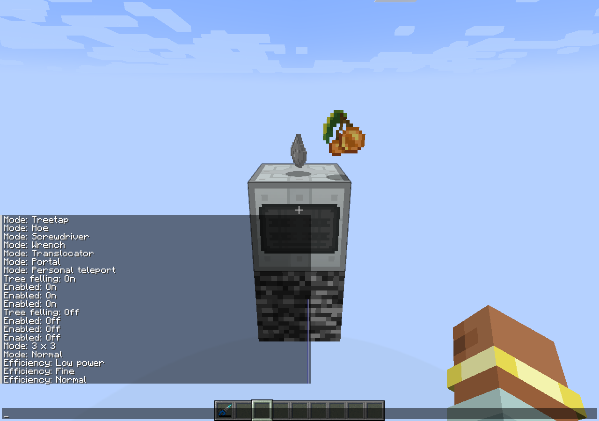

# Tool modes, native harvesting and balance audit — 1.4.6

## Bugs and fixes

Drills, Vajra and the advanced chainsaw defined the old Forge
`onBlockStartBreak(ItemStack, BlockPos, Player)` callback. Current NeoForge does
not call that method. Setting state and tooltips changed, but area/vein/tree
harvesting never ran through normal gameplay.

Additional harvesting now runs from the native server `mineBlock` callback, after
the center block passes normal server break checks. Each extra block goes through
`ServerPlayerGameMode.destroyBlock`, preserving protection events and normal
enchantment drops. The recursion guard prevents nested area/tree operations.
The original block is charged once, and additional blocks are charged only when
actually mined. Low charge reserves enough EU for the center; sneaking temporarily
limits the operation to one block. Native `canAttackBlock` checks reject an empty
tool instead of allowing free center mining.

GraviTool's delegated hoe action also lacked the current NeoForge hoe ability.
Hoe mode now exposes that ability, so it can actually till blocks. Treetap,
screwdriver and IC2R wrench actions retain their respective native behavior.

Tool changes use server-originated translatable chat components, once per action.
They follow IC2R's `Mode: Value` / `Режим: Значение` style, with similarly formatted
efficiency, enchantment, tree-felling and enabled-state notifications. Both direct
utility use and the magnet hotkey notify; both relocator UI and direct mode changes
use the same notification path. All new text has English and Russian locales.

Energy Control's player-send helper now checks channel negotiation before sending
custom packets. Server-side test actors or connections without that channel do not
receive unsupported Addons payloads.

## Current speed and EU values

Speed is the tool's base destroy-speed value on an effective block, before player
attributes, haste, enchantments and Minecraft's hardness/harvest formula. It is not
a literal blocks-per-second value. EU below is manual mining cost per successful
nonzero-hardness block. A full 3 x 3 plane costs nine operations, not one.

| Tool | Normal speed / EU | Low-power speed / EU | Fine speed / EU |
| --- | --- | --- | --- |
| IC2R mining drill | 8 / 50 | — | — |
| IC2R diamond drill | 16 / 80 | — | — |
| IC2R iridium drill | 24 / 800 | — | — |
| Addons advanced diamond drill | 48 / 160 | 24 / 80 | 16 / 50 |
| Addons advanced iridium drill | 72 / 1000 | 36 / 600 | 24 / 400 |
| Addons Vajra | 128 / 3200 | 64 / 1600 | 32 / 800 |
| IC2R chainsaw | 12 / 100 | — | — |
| Addons advanced chainsaw | 24 / 100 | — | — |

GraviTool retains IC2R integration costs: hoe and treetap 50 EU, screwdriver
150 EU, and native wrench handling. These are separate from the mining profiles.
The miner's `IMiningDrill` per-tick draw/break duration is a separate machine API;
it is not the manual mining cost listed above.

## Historical GraviSuite comparison

Historical versions and forks differ. This audit uses pinned public source, not
one assumed universal GraviSuite balance:

- [GraviSuite 2.0.3 advanced drill source in the FakePlayers patch repository](https://github.com/gamerforEA/GraviSuite-FakePlayers/blob/16a7dc02bc86d5aef90a6a876ab3b981ca83732f/src/main/java/gravisuite/ItemAdvDDrill.java)
  defines 35/16/10 speed and 160/80/50 EU, with a separate 3 x 3 mode at speed 16.
- [GraviSuiteReforged efficiency profiles](https://github.com/VintageModsReforged/GraviSuiteReforged/blob/b2d198cb4b5cc9f807d0c7112976baedaf924d7b/src/main/java/reforged/mods/gravisuite/items/features/IPropsProvider.java)
  also define drill speed 35/16/10 and EU 160/80/50. Vajra uses 20000/1000/100
  speed and 3200/1600/800 EU there.
- [The historical advanced chainsaw](https://github.com/VintageModsReforged/GraviSuiteReforged/blob/b2d198cb4b5cc9f807d0c7112976baedaf924d7b/src/main/java/reforged/mods/gravisuite/items/tools/ItemAdvancedChainsaw.java)
  uses speed 35 and 100 EU. Addons currently uses twice IC2R's native speed, 24.
- [The historical advanced iridium drill](https://github.com/VintageModsReforged/GraviSuiteReforged/blob/b2d198cb4b5cc9f807d0c7112976baedaf924d7b/src/main/java/reforged/mods/gravisuite/items/tools/ItemAdvancedDrill.java)
  declares speed 24 and 1000 EU; Addons has its existing three profiles above.
- [GraviSuite 2.0.3 Vajra](https://github.com/gamerforEA/GraviSuite-FakePlayers/blob/16a7dc02bc86d5aef90a6a876ab3b981ca83732f/src/main/java/gravisuite/ItemVajra.java)
  uses speed 20000 and 3333 EU, with a silk-touch toggle.

Thus Addons' diamond-drill EU profile matches the references, while its speeds
and several other tool profiles are existing adaptations. This bug-fix release
preserves those released values; it does not claim exact historical balance.

## Validation

The client smoke pass performs 40 actual server setting changes in each of English
and Russian, checking the resulting native client chat message and stored setting.
Each action must produce exactly one translated message. Coverage includes all
drill/Vajra mining and efficiency choices, enchantment choices, GraviTool's four
modes, relocator modes, tree felling and utility/hotkey toggles.

Native server harvest tests cover every mining/efficiency combination, all six
3 x 3 orientations, low charge, sneaking, empty tools, tree felling, actual silk
versus ordinary stone drops and all four GraviTool actions. Existing equipment
tests also cover protected containers, reserved item drops, filtered voiding,
teleportation, translocator projectiles, portal lifetime and cancelled placement.

See [the validation record](validation/1.4.6.json).

